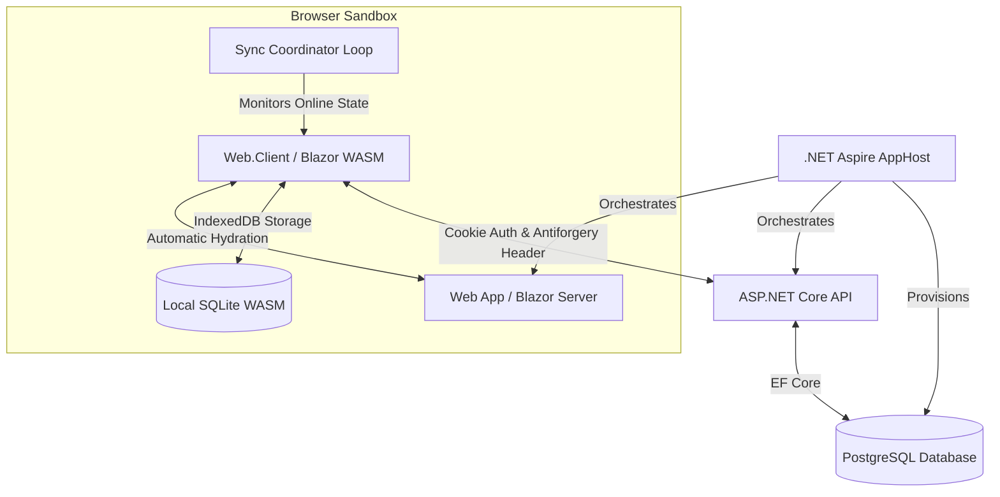

# Support Agent [](https://github.com/awoniyimuyiwa/support-agent/actions/workflows/dotnet.yml)

A robust, enterprise-grade **.NET 10** orchestration suite designed for modern, resilient customer support operations. Orchestrated via **.NET Aspire**, this system features a distributed multi-tenant API backend backed by **PostgreSQL** and an offline-first **Blazor InteractiveAuto** application utilizing an in-browser sandbox client **SQLite** engine with automated state synchronization. This project utilizes the **Blazor InteractiveAuto** render mode paired with client-side **SQLite** to balance immediate page-load speeds with uninterrupted offline operation. By rendering the initial view on the server while downloading the WebAssembly engine in the background, the workspace eliminates startup delays. Once loaded, execution shifts entirely to the browser sandbox, allowing users to remain productive, manage local queues, and queue data changes even during total network disconnections.

Prioritizes network resilience and security through:

* **Unified Orchestration (.NET Aspire)**: Fully managed service governance providing immediate local and cloud configuration topologies for databases, caching instances, proxy vectors, and application entry points out-of-the-box.
* **Zero-Flicker Identity (.NET 10 Serialization)**: Advanced state management that serializes the server-side authentication ticket and deep custom API claims seamlessly into the initial HTML footprint, eliminating client-side UI hydration flickering during WebAssembly boot stages.
* **Offline-First Data Storage (WASM SQLite)**: Fully sandboxed **SQLite database engine inside IndexedDB**, enabling client-side agents to create, view, and read operational datasets directly in the browser even when completely disconnected from the network.
* **Automated Sync Pipeline**: An asynchronous background process that runs on the client to automatically detect network availability, gracefully manage token expiration, resolve out-of-bounds idempotency batches, and push data up to the API once connectivity is restored.
* **Hardened BFF Protection**: Complete cookie-driven Backend-for-Frontend (BFF) boundary integration. The client sandbox handles background operations with strict Antiforgery validation, protecting the app from Cross-Site Request Forgery (CSRF).

## 🚀 Architectural Topology

The solution consists of projects organized into a modular Onion Architecture paired with a modern distributed hosting layout:



### 🛠 Tech Stack Matrix

* **Environment Orchestrator:** .NET Aspire (v10)
* **Client Core UI Engine:** Blazor InteractiveAuto (Server Prerendered + Client Hybrid execution)
* **Client Storage Model:** SQLite Wasm via Entity Framework Core inside browser `IndexedDB`
* **Backend Server Runtime:** .NET 10 SDK
* **Structural Architecture:** Onion Architecture (DDD, Repository Pattern, Shared Contract Validation)
* **Data Tier Persistence:** PostgreSQL Database Engine
* **Security Infrastructure:** SameSite Cookie-Based Authentication, Antiforgery HTTP Header Verification Handlers, and Automated .NET 10 Auth State Serializers

### 🔑 Authentication & Handshake Lifecycle

This application utilizes a custom architecture to decouple the web front-end from direct API state exposure while allowing smooth server-to-client claim transfers:

1. **Top-Level Request Evaluation**: The browser requests a secure app zone route. `CustomAuthenticationHandler` evaluates the incoming cookie context against the API user info service endpoint.
2. **State Serialization**: On successful evaluation, `.AddAuthenticationStateSerialization(options => options.SerializeAllClaims = true)` encrypts and embeds all retrieved custom identity claims directly into the HTML payload block.
3. **WASM Client Hydration**: As WebAssembly finishes loading in the browser background, `AddAuthenticationStateDeserialization()` reads the embedded state token, instantly giving the application its authentication context with zero flickering or extra initialization requests.
4. **BFF Security Boundary**: The browser security framework isolates operations through distinct cookie requirements:
    * **Authentication Identity Cookie**: Issued as `SameSite=Lax` to allow cross-site navigation entry and bookmark loading to hit the server-side pre-render pipeline safely.
    * **Antiforgery Cookie Structure**: Enforced as `SameSite=Strict` on both the BFF and API layer to block Cross-Site Request Forgery (CSRF) vulnerabilities entirely during background `POST`/`PUT`/`DELETE` calls.

### 🔄 The Sync Coordinator (Offline Processing Engine)

The core offline resilience engine lives inside `SyncCoordinator.razor` within the main design layout. It processes operations through an asynchronous looping task queue:

* **Online Validation Pass**: Continuously verifies browser network states. It uses an internal keep-alive loop to extend backend cookie session durations.
* **Session Demotion Mitigation**: If a background request encounters an unexpected `401 Unauthorized` token expiration status, the coordinator stops network checks and runs a hard browser reload `Nav.NavigateTo("/login", forceLoad: true)`. This flushes the active in-memory cache and returns the client app to a clean, locked-down state.
* **Idempotency Recovery Pass**: If a synchronization operation gets interrupted because a user closes a tab mid-transmission or their device shuts down, the coordinator finds the stranded batch keys in the client database at startup and restarts the operations to guarantee data integrity.

### 🛠 Troubleshooting & WASM Native Compilation

#### The `wasm-tools` Workload Error

If you encounter the following compilation blocker during build time:

```text
To build this project, the following workloads must be installed: wasm-tools
To install these workloads, run the following command: dotnet workload restore
```

#### Why This Happens

Standard Blazor WebAssembly applications compile C# code into intermediate language (IL) that is interpreted by the browser at runtime. However, to execute high-performance **SQLite in-browser database storage**, this project utilizes `SqliteWasmHelper` and specifies `<WasmBuildNative>true</WasmBuildNative>` inside the client configuration layer.

This instructs the build machine to execute a **Native AOT compilation / C-binary relink pass**. This process physically compiles and stitches the custom native SQLite C-source libraries directly into your client-side WebAssembly project output file streams. The `.NET SDK` requires the native **LLVM toolchain** included inside the `wasm-tools` payload to manage this linking procedure.

#### How to Fix It

Open your terminal, navigate to the root directory of your solution, and execute the workload restore command:

```bash
dotnet workload restore
```

**Alternative Explicit Installation Pass:**
While `dotnet workload restore` is the command the compiler suggests by default, it occasionally flags a success state without laying down the required OS binaries. If your environment fails to compile after a restore execution, install the toolchain explicitly:

```bash
dotnet workload install wasm-tools
dotnet workload restore
```

### 🔮 Upcoming Roadmap

* [ ] **Ticket Submission**: Client interface for users to submit support tickets directly to the platform.
* [ ] **Vector Documentation Embedding UI**: Administrative interface allowing file uploads to break text assets into contextual chunks, generate vector embeddings, and save data to a vector store.
* [ ] **Microsoft Agent Framework Integration**: Integration of autonomous AI support and verification agents to automatically parse, address, and reply to user tickets based on the vectorized documentation.

### 🚀 Getting Started

#### Prerequisites

* .NET 10 SDK
* Docker Desktop (Required for .NET Aspire)
* Visual Studio 2026 (v18.0+), Visual Studio 2022 (v17.12+), or VS Code

#### Installation & Launch

**Clone the Repository**:

```bash
git clone https://github.com/awoniyimuyiwa/suport-agent
cd SupportAgent
```

**Launch the Orchestration Environment**:

> [!IMPORTANT]
> **Docker Desktop must be running** on your local machine before starting the application. .NET Aspire depends on the Docker daemon to provision and link the infrastructure container network layers.

Open the solution file in Visual Studio and set `AppHost` as your startup project, or launch it directly from your terminal using the CLI:

```bash
dotnet run --project src/AppHost/AppHost.csproj
```

**Explore the App Host Dashboard**:

Click the URL displayed in your terminal to access the .NET Aspire dashboard. Here, you can monitor live connection configurations, inspect distributed OpenTelemetry traces, view console log matrices, and access endpoints for both the `Web` portal and the secure back-end `Api`.

#### 🧪 Testing

The solution contains tests built on top of **xUnit v3** and the modern **Microsoft Testing Platform (MTP)**

##### Core Unit Tests

Execute lightweight tests without container dependencies:

```bash
dotnet test tests/Api.UnitTests/Api.UnitTests.csproj
dotnet test tests/Application.UnitTests/Application.UnitTests.csproj
```

##### AppHost Integration Tests

The integration test project validates end-to-end cloud infrastructure handshakes by compiling the projects and spinning up emulators.

> [!WARNING]  
> **Docker Desktop must be active** before executing the integration tests below. The runner will spawn ephemeral containers.

```bash
dotnet test tests/AppHost.IntegrationTests/AppHost.IntegrationTests.csproj
```


